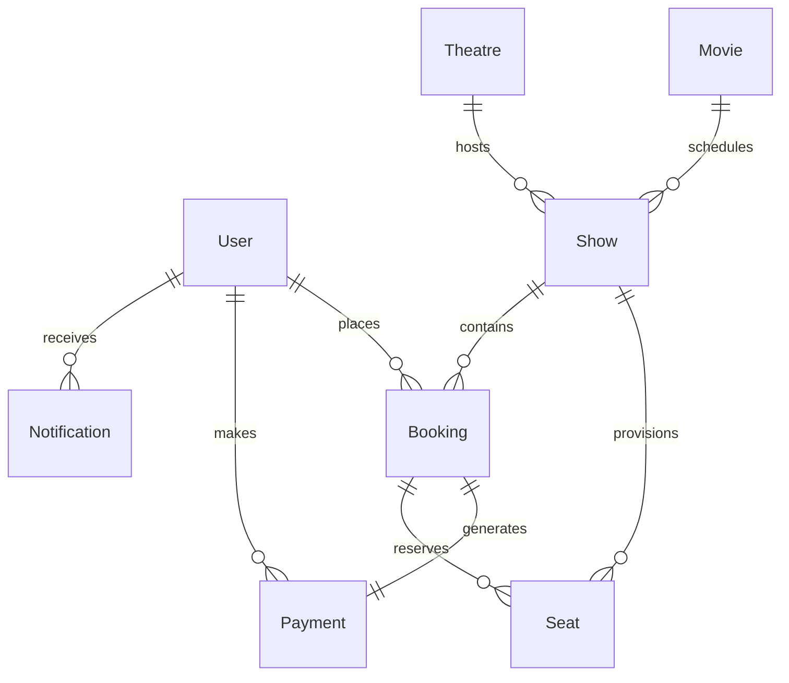

# 🎬 IMovies • Full-Stack Cinema Ticket Booking & Real-Time Management Platform

> **IMovies** is a full-stack MERN (MongoDB, Express.js, React.js, Node.js) web application engineered to deliver a seamless online cinema experience. Users can browse movies, explore theatre schedules, select seats on an interactive layout with real-time concurrency tracking, and receive instant digital QR-code ticket vouchers. Cinema administrators benefit from a control center for catalog management, theatre scheduling, and ticket revenue analytics.

---

## 🌟 Key Highlights & Features

- **Real-Time Seat Availability & Concurrency Locking**: Built with Socket.io; whenever a user selects a seat, it is temporarily locked and visually updated across all connected clients to prevent double-booking.
- **Interactive Multi-Tier Seat Map**: Visual theatre layout categorized into **Standard ($14)**, **Premium ($20)**, and **VIP Recliners ($28)** with live 10-minute hold countdown timer.
- **Digital QR Ticket Vouchers**: Instant ticket generation rendered with SVG QR codes for contactless theatre turnstile entry, including print/save to PDF capabilities.
- **Role-Based Authentication (JWT & bcrypt)**: Granular access control for `User` and `Admin` roles with protected API routes and rate limiting.
- **Dynamic Promo Codes**: Support for coupon validation (`IMOVIES20` for 20% off, `FIRST50` for 50% off, `FLAT10` for $10 flat discount).
- **Hassle-Free Cancellations & Refunds**: Instant refund calculations and automatic seat release up to 1 hour before showtime.
- **Admin Control Portal**:
  - Live revenue & booking analytics metrics
  - Full CRUD for movie catalog with trailer links and posters
  - Cinema theatre and screen configuration
  - Interactive show scheduler that auto-generates 80-seat layouts
  - Master booking logs with search and filter capabilities
- **Zero-Friction Database Setup**: Automatic fallback to in-memory MongoDB with automated seeder, so the application runs immediately without requiring an external MongoDB server setup.

---

## 🛠️ Tech Stack & Skills Architecture

| Layer | Technologies |
| :--- | :--- |
| **Frontend** | React 19, Vite, React Router v7, Axios, Socket.io-client, Lucide Icons, Canvas Confetti, QRCode.react, Custom Cinema Glassmorphic CSS |
| **Backend** | Node.js, Express.js, Socket.io (WebSockets), Multer (File uploads), Morgan (Logging), Express Rate Limit |
| **Database** | MongoDB, Mongoose ODM, MongoDB-Memory-Server (zero-friction fallback) |
| **Security** | JSON Web Tokens (JWT), bcrypt.js password encryption, role-based middleware, IP rate limiting |

---

## 🗄️ Database Design (8 Collections)



1. **`Users`**: `name`, `email`, `password` (bcrypt), `role` (`'user' | 'admin'`), `phone`, `preferredCity`, `avatar`.
2. **`Movies`**: `title`, `tagline`, `description`, `genres`, `language`, `duration`, `releaseDate`, `rating`, `director`, `cast`, `posterUrl`, `backdropUrl`, `trailerUrl`, `status` (`'now_showing' | 'coming_soon'`), `featured`.
3. **`Theatres`**: `name`, `city`, `address`, `screens` (`name`, `screenType`, `totalSeats`), `amenities`, `contactNumber`.
4. **`Shows`**: `movie` (ref), `theatre` (ref), `screenName`, `showTime`, `endTime`, `priceTier` (`standard`, `premium`, `vip`), `status`, `totalSeats`, `availableSeatsCount`.
5. **`Seats`**: `show` (ref), `seatNumber`, `row`, `col`, `category`, `price`, `status` (`'available' | 'locked' | 'booked' | 'blocked'`), `lockedBy`, `lockExpiresAt`.
6. **`Bookings`**: `bookingNumber`, `user` (ref), `show` (ref), `movie` (ref), `theatre` (ref), `seats` (array), `subtotal`, `convenienceFee`, `discount`, `totalAmount`, `status` (`'confirmed' | 'cancelled'`), `qrCode`.
7. **`Payments`**: `booking` (ref), `user` (ref), `paymentMethod` (`'card' | 'upi' | 'netbanking' | 'wallet'`), `transactionId`, `amount`, `status`.
8. **`Notifications`**: `user` (ref), `title`, `message`, `type`, `isRead`.

---

## 🚀 Quick Start Guide

### 1. Prerequisites
- Node.js (v18+)
- npm (v9+)

### 2. Environment Configuration
Create or edit `server/.env`:
```env
PORT=5000
MONGODB_URI=mongodb://localhost:27017/imovies
JWT_SECRET=imovies_super_secret_jwt_key_2026_cinema_secure
JWT_EXPIRES_IN=7d
CLIENT_URL=http://localhost:5173
NODE_ENV=development
```

### 3. Installation
Install server dependencies:
```bash
cd server
npm install
```

Install client dependencies:
```bash
cd client
npm install
```

### 4. Running the Development Servers

**Start Backend (Port 5000):**
```bash
cd server
npm start
```
*(The backend automatically seeds blockbuster movies, theatres, and demo accounts upon first start).*

**Start Frontend (Port 5173):**
```bash
cd client
npm run dev
```

Visit **`http://localhost:5173`** in your browser.

---

## 🔑 Demo Credentials

| Role | Email | Password | Access |
| :--- | :--- | :--- | :--- |
| **Admin** | `admin@imovies.com` | `Admin@123` | Full Admin Portal, Movie CRUD, Show Scheduler, Analytics |
| **User** | `user@imovies.com` | `User@123` | Ticket booking, Seat hold, Payment, Dashboard, Cancellations |

*(Both login accounts can also be filled with 1 click using the "Demo Admin" and "Demo User" buttons inside the sign-in modal).*

---

## 📡 REST API Reference

### Authentication
- `POST /api/auth/register` - Create new customer account
- `POST /api/auth/login` - Authenticate user & retrieve JWT token
- `GET /api/auth/me` - Get current authenticated user profile
- `PUT /api/auth/profile` - Update profile name, phone, city
- `PUT /api/auth/password` - Change password

### Movies
- `GET /api/movies` - Search & filter movies (`genre`, `language`, `status`, `search`, `page`, `limit`)
- `GET /api/movies/featured` - Get featured movies for hero carousel
- `GET /api/movies/genres` - Get distinct genres
- `GET /api/movies/:id` - Get movie details and upcoming showtimes
- `POST /api/movies` *(Admin)* - Create new movie
- `PUT /api/movies/:id` *(Admin)* - Update movie details
- `DELETE /api/movies/:id` *(Admin)* - Delete movie & cascade cancelled shows

### Theatres & Shows
- `GET /api/theatres` - Get cinema theatres filtered by city
- `GET /api/theatres/cities` - Get available cities
- `GET /api/shows` - Get scheduled shows by `movieId`, `theatreId`, `city`, `date`
- `GET /api/shows/:id` - Get show details with real-time seat matrix
- `POST /api/shows` *(Admin)* - Schedule screening & provision 80-seat grid
- `DELETE /api/shows/:id` *(Admin)* - Cancel scheduled show

### Bookings & Payments
- `POST /api/bookings` - Reserve seats, validate hold, apply coupon, and confirm booking
- `GET /api/bookings/my` - Get customer bookings (filterable by `upcoming` and `past`)
- `GET /api/bookings/:id` - Get detailed booking with digital QR ticket
- `PUT /api/bookings/:id/cancel` - Cancel booking & process refund
- `GET /api/bookings/admin/all` *(Admin)* - Master booking logs

### Analytics & Notifications
- `GET /api/analytics/dashboard` *(Admin)* - Total revenue, occupancy, ticket sales, recent bookings
- `GET /api/notifications` - Retrieve customer notifications
- `PUT /api/notifications/mark-all-read` - Mark all unread notifications as read

---

## 🧪 Automated Integration Tests

Run the full end-to-end integration test suite:
```bash
cd server
npm test
```
The test suite validates:
1. API Health Check
2. Admin JWT authentication
3. User JWT authentication
4. Movie search & genre filters
5. Theatre discovery
6. Show scheduling
7. Seat matrix generation
8. Atomic seat reservation & coupon application
9. User booking dashboard verification
10. Booking cancellation & refund processing
11. Admin dashboard revenue calculation
