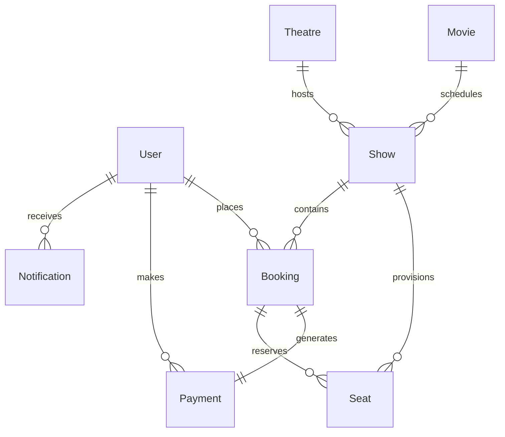

# 🎬 IMovies • Full-Stack Cinema Ticket Booking & Real-Time Management Platform

[](https://react.dev/)
[](https://vitejs.dev/)
[](https://expressjs.com/)
[](https://www.mongodb.com/)
[](https://socket.io/)
[-yellow.svg)](#)
[](#)

> **IMovies** is a production-grade, full-stack MERN cinema ticketing web application designed for moviegoers and cinema administrators. Users can browse movies, select shows across nearby cinema multiplexes in **Bhopal, Madhya Pradesh**, reserve seats on an interactive layout with **real-time concurrency locking**, and checkout with instant digital QR-code ticket vouchers.

---

## 🌟 Key Features & Updates

### 📍 Localized for Bhopal, India
- **Primary Hub**: Bhopal, Madhya Pradesh (with regional discovery across Indore, Mumbai, Delhi, and Bengaluru).
- **Nearby Bhopal Cinema Multiplexes**:
  - **Cinepolis: DB City Mall** (Arera Hills, MP Nagar Zone 1) — IMAX 3D Laser & Dolby Atmos
  - **PVR: Aura Mall** (Gulmohar Colony, Shahpura / Arera Colony) — P[XL] Dolby Atmos
  - **INOX: Aashima Mall** (Hoshangabad Road, Bawadiya Kalan) — Insignia VIP Lounge
  - **DDX Cinemas: People’s Mall** (Karond / Bhanpur Bypass Road) — Mega Screen 3D
  - **Jyoti Cineplex** (Zone-I, MP Nagar) — Centrally Air-Conditioned Classic Cinema
  - *(Regional Option: **PVR: Phoenix Citadel**, Indore)*
- **Local Support Helpline**: `+91 (755) 400-FILM`

---

### 🎟️ Reasonable Indian Rupee (₹) Pricing
- **Standard Seats**: **₹150** (Dolby 7.1 surround sound, classic auditorium seats)
- **Premium Seats**: **₹220** (Extra legroom, prime central viewing angle, Dolby Atmos)
- **VIP Recliners**: **₹320** (Plush motorized leather recliners, in-seat food service)
- **Convenience Fee**: **₹25** per ticket
- **Simulated Wallet Balance**: **₹1,500.00**
- **Discount Coupons**:
  - `IMOVIES20` — 20% Instant Discount (up to ₹100 off)
  - `FIRST50` — Flat ₹50 off on first booking
  - `FLAT100` — Flat ₹100 off on bookings above ₹500

---

### 🌺 Moana 2 Featured Release
- Featured on the Home Page hero banner with custom high-resolution display artwork: Moana, Maui, ocean voyaging banner ([`moana2.jpg`](client/public/images/moana2.jpg)).
- Scheduled daily across Bhopal screens with real-time seat matrices.

---

### ⚡ Real-Time Concurrency & Booking Workflow
- **Interactive Multi-Tier Seat Map**: Visual theatre layout categorized into Standard, Premium, and VIP rows.
- **WebSocket Seat Hold Engine**: Powered by **Socket.io**. As soon as a user clicks a seat, it locks across all connected browser tabs with a live countdown timer, preventing duplicate seat reservations.
- **Digital QR Ticket Vouchers**: Instant ticket generation rendered with SVG QR codes for turnstile scanning, with print and PDF capabilities.
- **Hassle-Free Cancellations & Instant Refunds**: One-click cancellation with automated refund processing up to 1 hour prior to showtime.
- **Role-Based Authentication**: Secure JWT + bcrypt authentication for `user` and `admin` roles with protected API middleware.
- **Admin Control Portal**:
  - Real-time revenue, booking counts, and occupancy analytics
  - Full CRUD for movie catalog (add, edit, delete with poster & backdrop URLs)
  - Theatre and screen management
  - Show scheduler that auto-generates 80-seat layouts
  - Master booking logs with search and filter capabilities

---

## 🛠️ Tech Stack

| Layer | Technologies |
| :--- | :--- |
| **Frontend** | React 19, Vite, React Router v7, Axios, Socket.io-client, Lucide Icons, Canvas Confetti, QRCode.react, Glassmorphic Cinema CSS |
| **Backend** | Node.js, Express.js, Socket.io (WebSockets), Multer, Morgan, Express Rate Limit |
| **Database** | MongoDB, Mongoose ODM, MongoDB-Memory-Server (automatic zero-friction fallback) |
| **Security** | JSON Web Tokens (JWT), bcrypt.js password hashing, role-based route guards, IP rate limiting |

---

## 🗄️ Database Architecture (8 Collections)



1. **`Users`**: `name`, `email`, `password` (bcrypt), `role` (`'user' | 'admin'`), `phone`, `preferredCity`, `avatar`.
2. **`Movies`**: `title`, `tagline`, `description`, `genres`, `language`, `duration`, `releaseDate`, `rating`, `director`, `cast`, `posterUrl`, `backdropUrl`, `trailerUrl`, `status` (`'now_showing' | 'coming_soon'`), `featured`.
3. **`Theatres`**: `name`, `city`, `address`, `screens` (`name`, `screenType`, `totalSeats`), `amenities`, `contactNumber`.
4. **`Shows`**: `movie` (ref), `theatre` (ref), `screenName`, `showTime`, `endTime`, `priceTier` (`standard`, `premium`, `vip`), `status`, `totalSeats`, `availableSeatsCount`.
5. **`Seats`**: `show` (ref), `seatNumber`, `row`, `col`, `category`, `price`, `status` (`'available' | 'locked' | 'booked' | 'blocked'`), `lockedBy`, `lockExpiresAt`.
6. **`Bookings`**: `bookingNumber`, `user` (ref), `show` (ref), `movie` (ref), `theatre` (ref), `seats` (array), `subtotal`, `convenienceFee`, `discount`, `totalAmount`, `status` (`'confirmed' | 'cancelled'`), `qrCode`.
7. **`Payments`**: `booking` (ref), `user` (ref), `paymentMethod` (`'card' | 'upi' | 'netbanking' | 'wallet'`), `currency` (`'INR'`), `transactionId`, `amount`, `status`.
8. **`Notifications`**: `user` (ref), `title`, `message`, `type`, `isRead`.

---

## 🚀 Quick Start Guide

### Option A: One-Click Startup (Windows)
Double-click the launcher script located in the project root:
- **`start-all.bat`** — Launches both backend API (Port 5000) and frontend client (Port 5173).

---

### Option B: Manual Startup

#### 1. Prerequisites
- **Node.js** (v18+)
- **npm** (v9+)
- *(Optional)* MongoDB running on `mongodb://localhost:27017` *(If MongoDB is not installed, the server automatically boots an in-memory database or operates in offline demo mode seamlessly).*

#### 2. Setup Server
```bash
cd server
npm install
npm run seed     # Seeds Bhopal theatres, Moana 2, and movie catalog
npm start        # Runs on http://localhost:5000
```

#### 3. Setup Client
```bash
cd client
npm install
npm run dev      # Runs on http://localhost:5173
```
Open **[http://localhost:5173](http://localhost:5173)** in your browser.

---

## 🔑 Demo Login Accounts

| Role | Email | Password | Access Rights |
| :--- | :--- | :--- | :--- |
| **Cinema Admin** | `admin@imovies.com` | `Admin@123` | Full Admin Portal, Movie CRUD, Show Scheduler, Revenue Analytics |
| **Standard User** | `user@imovies.com` | `User@123` | Ticket booking, Seat hold, Payment, User Dashboard, Cancellations |

*(Both accounts can also be auto-filled with 1 click using the "Demo Admin" and "Demo User" buttons in the Sign In modal).*

---

## 📡 Backend REST API Reference

### 🔐 Authentication (`/api/auth`)
- `POST /api/auth/register` - Register a new customer
- `POST /api/auth/login` - Authenticate & return JWT
- `GET /api/auth/me` - Get logged-in user profile
- `PUT /api/auth/profile` - Update profile (name, phone, preferred city)
- `PUT /api/auth/password` - Change password

### 🎬 Movies (`/api/movies`)
- `GET /api/movies` - Search & filter movies (`genre`, `language`, `status`, `search`)
- `GET /api/movies/featured` - Get featured movies for hero banner
- `GET /api/movies/genres` - Get unique genres list
- `GET /api/movies/:id` - Get movie details and upcoming showtimes
- `POST /api/movies` *(Admin)* - Create a new movie
- `PUT /api/movies/:id` *(Admin)* - Update movie details
- `DELETE /api/movies/:id` *(Admin)* - Delete movie & cascade cancelled shows

### 🏛️ Theatres & Shows (`/api/theatres`, `/api/shows`)
- `GET /api/theatres` - Get cinema theatres filtered by city (Bhopal, Indore, etc.)
- `GET /api/theatres/cities` - Get list of active cinema cities
- `GET /api/shows` - Query shows by `movieId`, `theatreId`, `city`, `date`
- `GET /api/shows/:id` - Get show details with live real-time seat matrix
- `POST /api/shows` *(Admin)* - Schedule screening & provision 80-seat grid
- `DELETE /api/shows/:id` *(Admin)* - Cancel scheduled show

### 💳 Bookings & Payments (`/api/bookings`, `/api/payments`)
- `POST /api/bookings` - Reserve seats, validate hold, apply coupon, confirm booking
- `GET /api/bookings/my` - Get user bookings (`upcoming` & `past`)
- `GET /api/bookings/:id` - Get booking voucher with digital QR ticket
- `PUT /api/bookings/:id/cancel` - Cancel booking and trigger instant refund
- `GET /api/bookings/admin/all` *(Admin)* - Master booking logs

### 📊 Analytics (`/api/analytics`)
- `GET /api/analytics/dashboard` *(Admin)* - Total revenue (₹), occupancy rate, ticket sales, recent transactions

---

## 🧪 Automated Test Suite

Run the end-to-end integration test suite verifying 11 critical endpoints:
```bash
cd server
npm test
```
The test suite validates:
1. API Health Check & Database connectivity
2. Admin JWT authentication & authorization
3. User JWT authentication
4. Movie catalog search & genre filters
5. Bhopal theatre discovery
6. Show scheduling engine
7. Real-time seat matrix generation
8. Atomic seat locking & coupon calculation
9. User booking dashboard retrieval
10. Booking cancellation & refund processing
11. Admin dashboard revenue aggregation

---

## 📦 Pushing Updates to GitHub

```powershell
cd C:\imovies
git add .
git commit -m "docs: update README with Bhopal theatres, INR pricing, Moana 2 assets, and full API documentation"
git branch -M main
git push -u origin main
```

---

## 📜 License
This project was built for academic and portfolio demonstration purposes. All movie posters, titles, and trademarks are the property of their respective owners.
